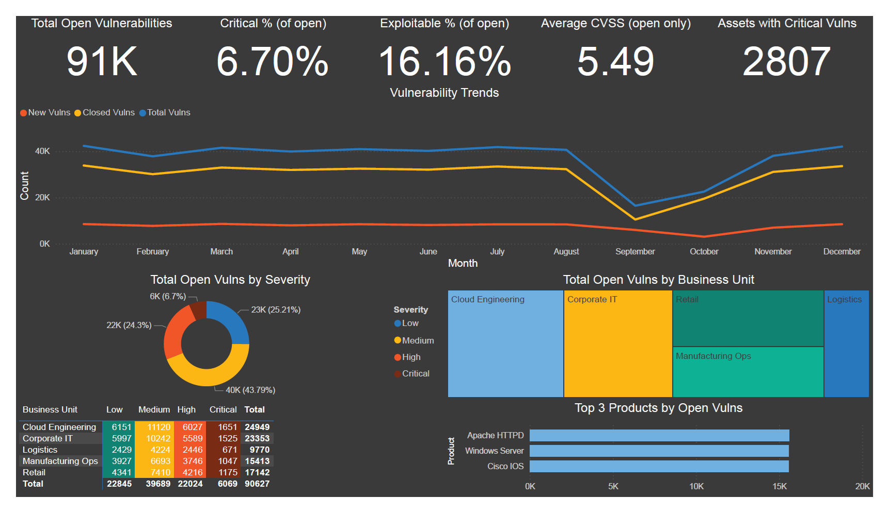
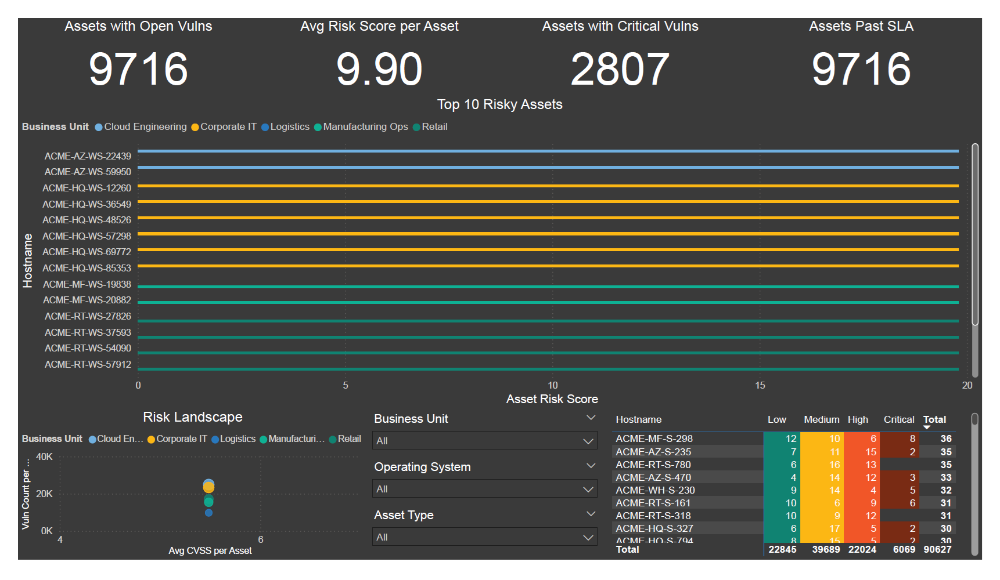
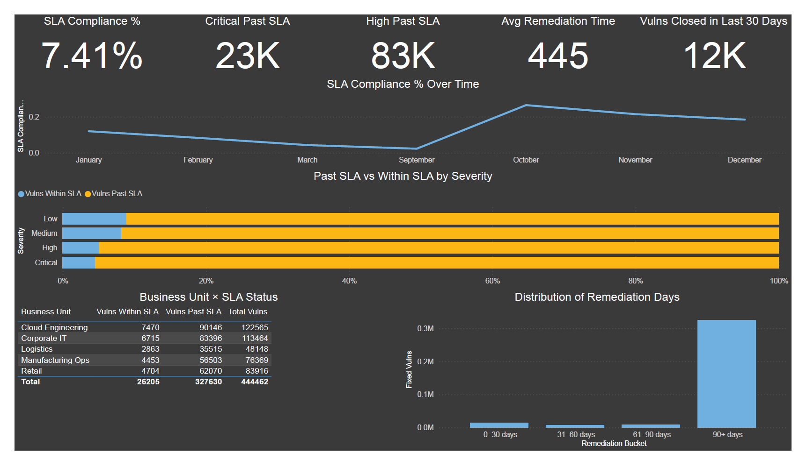

# Vulnerability Management Dashboards

A Power BI reporting suite for vulnerability management, featuring executive-level risk posture views and operational drilldowns for remediation teams. Built from mock scan data spanning one year of weekly scans to demonstrate data modeling, DAX calculations, and cybersecurity reporting in Power BI.

## Data Model

Star schema design with fact and dimension tables for scalable analytics. This structure enables efficient querying and provides the foundation for all dashboard visualizations and calculations.

## Dashboards

### 1. Executive Overview

**Audience:** CISOs, Senior Management
**Purpose:** High-level snapshot of organizational exposure

**Metrics:** Total open vulnerabilities, Critical %, Exploitable %, Average CVSS (open), Assets with critical vulns

**Visualizations:**
- Line chart: Backlog vs new vs closed vulnerabilities over time
- Donut chart: Severity distribution
- Treemap: Open vulnerabilities by business unit
- Heatmap matrix: Business unit x severity
- Top products: Most affected technologies

Executives quickly see exposure, risk concentration, and whether remediation efforts are reducing backlog.

---

### 2. Asset Risk View

**Audience:** Infrastructure / Remediation Teams
**Purpose:** Identify assets carrying the most risk

**Metrics:** Assets with open vulnerabilities, Average risk score per asset (CVSS-weighted), Assets with critical vulnerabilities, Assets past SLA

**Visualizations:**
- Bar chart: Top 10 risky assets
- Scatter/bubble plot: Risk landscape (Avg CVSS x vulnerability count, bubble size = risk score, color = business unit)
- Matrix: Assets x severity
- Slicers: Filter by business unit, OS, asset type

Operations teams identify hotspots -- assets with both high severity and many vulnerabilities.

---

### 3. Vulnerability Explorer (CVE Focus)

**Audience:** Security Analysts, Incident Responders
**Purpose:** Investigate specific CVEs across the estate

**Metrics:** Total open instances, Assets affected, Exploitable %, Average CVSS

**Visualizations:**
- Bar chart: Affected business units
- Table: Assets impacted (hostname, business unit, OS, severity, status, scan date)
- Metadata panel: CVE description, vector, solution, references
- Slicers: CVE, severity, exploitable flag, product

Analysts can pivot to a single CVE (e.g., Log4Shell) and instantly see scope, affected assets, and remediation guidance.

---

### 4. Time and Trends

**Audience:** Executives and Governance Teams
**Purpose:** Long-term risk posture and remediation velocity analysis

**Metrics:** New vulnerabilities (this month), Closed vulnerabilities (this month), Net change (backlog growth or reduction), Average remediation time (days)

**Visualizations:**
- Line chart: Backlog vs new vs closed trend
- Stacked area chart: Open vulnerabilities by severity over time
- Line chart: Average CVSS of new vulnerabilities per month

Leaders see whether security posture is improving or deteriorating over time.

---

### 5. SLA and Remediation Tracking

**Audience:** Risk/Compliance, Operations Managers
**Purpose:** Track remediation performance vs SLA targets

**Metrics:** SLA compliance % (within defined thresholds per severity), Critical/High past SLA counts, Average remediation time, Vulnerabilities closed in last 30 days

**Visualizations:**
- Line chart: SLA compliance % trend
- Stacked bar chart: Within SLA vs past SLA, by severity
- Matrix: Business unit x SLA compliance
- Histogram: Distribution of remediation days (0-30, 31-60, 61-90, 90+)

Accountability dashboard highlighting where SLA targets are being missed, broken down by severity and business unit.

---

### 6. Scan and Plugin Diagnostics

**Audience:** Vulnerability Management Engineers
**Purpose:** Validate scanner health and plugin effectiveness

**Metrics:** Total scans, Unique assets scanned, Average scan coverage %, Top plugin (by findings)

**Visualizations:**
- Line chart: Assets scanned per week
- Bar chart: Top plugins by findings
- Donut chart: Scan status (success/failure)
- Table: Scan diagnostics (scan ID, date, scanner, assets scanned, plugin count)
- Bar chart: Assets past SLA by scanner

Detects blind spots -- ensures scanning is consistent, plugins are firing as expected, and failures are investigated.

## Technical Details

- **Platform:** Microsoft Power BI
- **Data Model:** Star schema (fact and dimension tables)
- **Data Source:** Mock scan data, one year of weekly scans
- **Techniques:** DAX measures, calculated columns, role-level security patterns, bookmark navigation

## Note

Dashboards are built from generated mock data for demonstration purposes. Some visualizations may reflect artifacts of the synthetic data rather than real-world patterns.

## License

MIT License.
