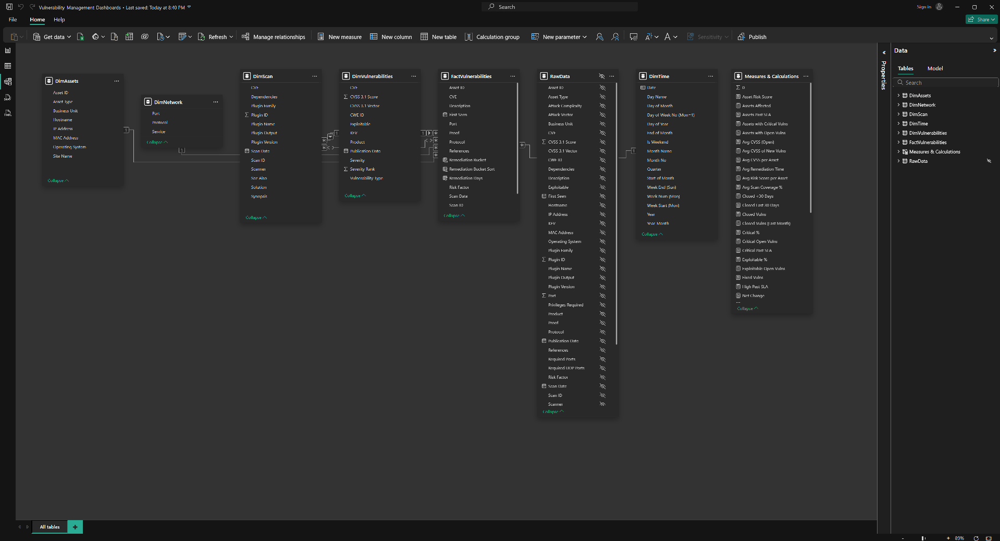
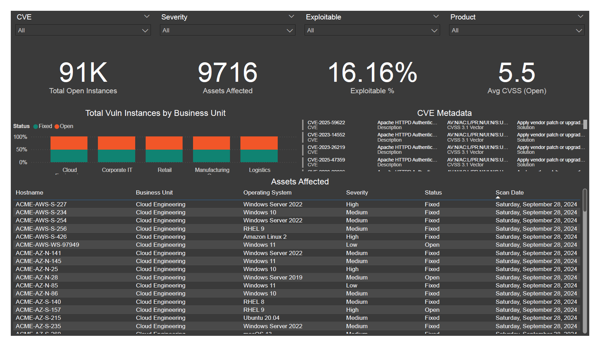
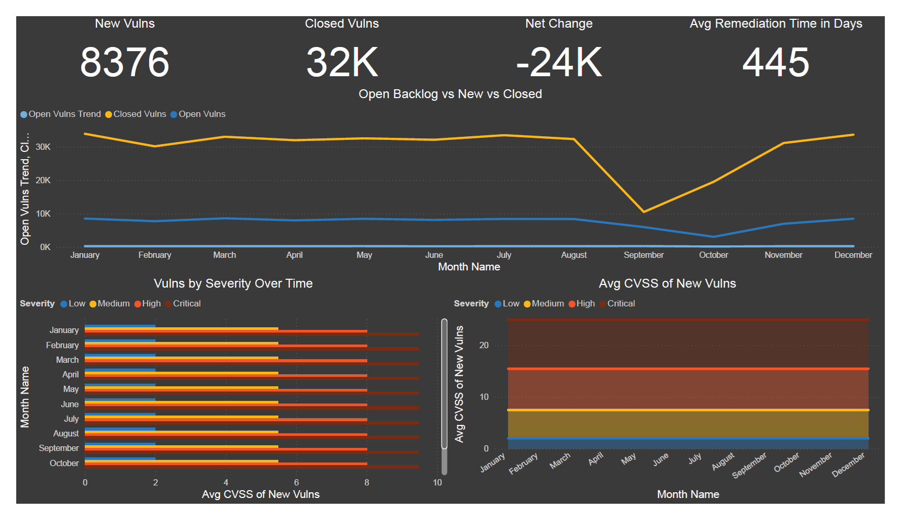
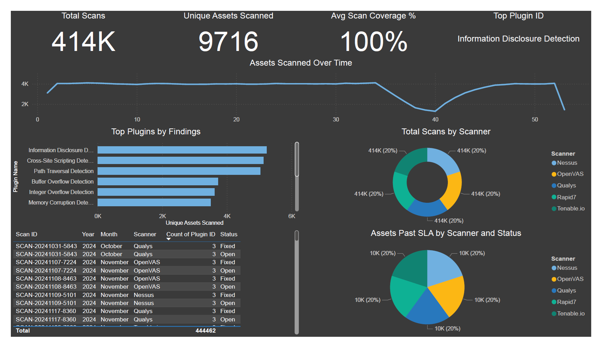

# Vulnerability Management Dashboards

Screenshots of a Power BI report for vulnerability management: executive-level risk posture views and operational drilldowns for remediation teams. The report was built on mock scan data spanning one year of weekly scans.

**These are illustrative mockups.** The Power BI file (.pbix or .pbit), the DAX measures and the mock data are not in this repository, so nothing here can be opened, rebuilt or checked. Several screenshots also show measures that return wrong values. See [Known issues in the screenshots](#known-issues-in-the-screenshots) before you take any number or chart from these images as a model.

## Data Model

The model has dimension tables (DimAssets, DimNetwork, DimScan, DimTime, DimVulnerabilities), a fact table (FactVulnerabilities) and a Measures table. A wide RawData table also sits in the model, and DimNetwork shows no relationship line. It is star-shaped, not a clean star schema.

## Dashboards

### 1. Executive Overview

**Audience:** CISOs, Senior Management
**Purpose:** High-level snapshot of organizational exposure

**Metrics:** Total open vulnerabilities, Critical %, Exploitable %, Average CVSS (open), Assets with critical vulns

**Visualizations:**
- Line chart: Backlog vs new vs closed vulnerabilities over time
- Donut chart: Severity distribution
- Treemap: Open vulnerabilities by business unit
- Heatmap matrix: Business unit x severity
- Top products: Most affected technologies

Executives quickly see exposure, risk concentration, and whether remediation efforts are reducing backlog.

---

### 2. Asset Risk View

**Audience:** Infrastructure / Remediation Teams
**Purpose:** Identify assets carrying the most risk

**Metrics:** Assets with open vulnerabilities, Average risk score per asset (CVSS-weighted), Assets with critical vulnerabilities, Assets past SLA

**Visualizations:**
- Bar chart: Top 10 risky assets
- Scatter/bubble plot: Risk landscape (Avg CVSS x vulnerability count, bubble size = risk score, color = business unit)
- Matrix: Assets x severity
- Slicers: Filter by business unit, OS, asset type

Operations teams identify hotspots -- assets with both high severity and many vulnerabilities.

---

### 3. Vulnerability Explorer (CVE Focus)

**Audience:** Security Analysts, Incident Responders
**Purpose:** Investigate specific CVEs across the estate

**Metrics:** Total open instances, Assets affected, Exploitable %, Average CVSS

**Visualizations:**
- Bar chart: Affected business units
- Table: Assets impacted (hostname, business unit, OS, severity, status, scan date)
- Metadata panel: CVE description, vector, solution, references
- Slicers: CVE, severity, exploitable flag, product

Analysts can pivot to a single CVE (e.g., Log4Shell) and instantly see scope, affected assets, and remediation guidance.

---

### 4. Time and Trends

**Audience:** Executives and Governance Teams
**Purpose:** Long-term risk posture and remediation velocity analysis

**Metrics:** New vulnerabilities (this month), Closed vulnerabilities (this month), Net change (backlog growth or reduction), Average remediation time (days)

**Visualizations:**
- Line chart: Backlog vs new vs closed trend
- Stacked area chart: Open vulnerabilities by severity over time
- Line chart: Average CVSS of new vulnerabilities per month

Leaders see whether security posture is improving or deteriorating over time.

---

### 5. SLA and Remediation Tracking

**Audience:** Risk/Compliance, Operations Managers
**Purpose:** Track remediation performance vs SLA targets

**Metrics:** SLA compliance % (within defined thresholds per severity), Critical/High past SLA counts, Average remediation time, Vulnerabilities closed in last 30 days

**Visualizations:**
- Line chart: SLA compliance % trend
- Stacked bar chart: Within SLA vs past SLA, by severity
- Matrix: Business unit x SLA compliance
- Histogram: Distribution of remediation days (0-30, 31-60, 61-90, 90+)

Accountability dashboard highlighting where SLA targets are being missed, broken down by severity and business unit.

---

### 6. Scan and Plugin Diagnostics

**Audience:** Vulnerability Management Engineers
**Purpose:** Validate scanner health and plugin effectiveness

**Metrics:** Total scans, Unique assets scanned, Average scan coverage %, Top plugin (by findings)

**Visualizations:**
- Line chart: Assets scanned per week
- Bar chart: Top plugins by findings
- Donut chart: Scan status (success/failure)
- Table: Scan diagnostics (scan ID, date, scanner, assets scanned, plugin count)
- Bar chart: Assets past SLA by scanner

Detects blind spots -- ensures scanning is consistent, plugins are firing as expected, and failures are investigated.

## Technical Details

- **Platform:** Microsoft Power BI
- **Data Model:** Star-shaped (dimension tables, one fact table and a wide raw table; see Data Model above)
- **Data Source:** Mock scan data, one year of weekly scans (not included)
- **Techniques:** DAX measures and calculated columns appear in the model screenshot. Role-level security and bookmark navigation are not shown anywhere in this repository, so they cannot be verified

## Note

Dashboards are built from generated mock data for demonstration purposes. Some visualizations may reflect artifacts of the synthetic data rather than real-world patterns. The CVE Explorer screenshot, for example, lists CVE-2025 IDs on scans dated September 2024, and every CVE has the same description and CVSS vector. The scan page shows five different scanners covering one estate.

## Known issues in the screenshots

These are errors in the screenshots themselves, not artifacts of the mock data. They cannot be fixed without the Power BI file, and the images have not been edited.

- **Scan and Plugin Diagnostics:** Total Scans shows 414K, and the Total Scans by Scanner donut shows 414K (20%) for each of five scanners. A measure that returns the grand total for every scanner is ignoring filter context. 414K also looks like a count of finding rows, not scans. Assets Past SLA by Scanner shows 10K for every scanner for the same reason. The Top Plugin ID tile shows a plugin name.
- **Time and Trends:** Avg CVSS of New Vulns has an axis that runs past 20, but CVSS tops out at 10. The severity chart is horizontal bars of average CVSS and stops at October, not the stacked area chart of open vulnerabilities by severity described above.
- **SLA and Remediation Tracking:** SLA Compliance % has an axis of 0.0 to 0.2 (a fraction, not a percent) and the trend skips April to August. Critical Past SLA (23K) and High Past SLA (83K) are far above the 6,069 open criticals on the Executive Overview, and the 444,462 total vulnerabilities do not match the 90,627 open there.
- **Asset Risk View:** The Top 10 Risky Assets chart shows at least 14 hostnames, all with the same bar length (clipped at the axis maximum of 20). Assets with Open Vulns and Assets Past SLA are both 9,716, so every asset is past SLA.
- **Executive Overview:** The totals add up (22,845 + 39,689 + 22,024 + 6,069 = 90,627) and no errors were found there.

## License

MIT License. See the [LICENSE](LICENSE) file.
